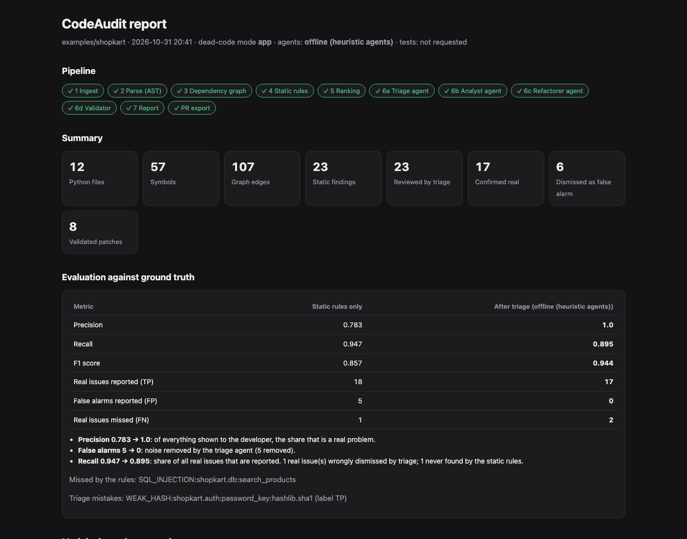

# CodeAudit — Autonomous Codebase Auditor & Refactoring Agent

**Problem.** AI models can't debug or fix a whole repository: paste one file into a chatbot and it
doesn't know who calls that function, whether user input reaches it, or what breaks if it changes.

**Solution.** CodeAudit ingests a repository (local folder or GitHub URL), builds a **dependency graph**,
runs **static analysis** to find candidates, and then gives **LLM agents** exactly the repository context
each finding needs: callers, entry path, taint path, blast radius, cycle edges. Agents triage the
findings, explain them, and write fixes. A deterministic **validator** re-runs the whole analysis and the
project's tests on every fix. Validated fixes become **pull requests**.

It works with Claude, any OpenAI-compatible API (OpenAI, Gemini, Groq, OpenRouter, a local Ollama model,
or a custom URL), or **fully offline** with heuristic agents.

By **Arbind Agarwal**, VIT. Final review: 30.10.2026.

> **Built with AI.** This project was made with **Claude** (Anthropic's AI model), using Claude Code.
> Most of the code, tests and documentation were written by Claude, directed and reviewed by me.

Review guide (brief → feature map, demo script): [`docs/FINAL_REVIEW.md`](docs/FINAL_REVIEW.md) ·
slides: [`docs/CodeAudit_Presentation.pptx`](docs/CodeAudit_Presentation.pptx).



## Quick start

```bash
python -m venv .venv
# Windows:  .venv\Scripts\activate        macOS/Linux:  source .venv/bin/activate
pip install -r requirements.txt          # only networkx + pytest. No AI SDK needed
python -m pytest -q                      # expect: 45 passed

python -m codeaudit audit examples/shopkart --run-tests --labels examples/shopkart_labels.csv --open
python -m codeaudit serve --open         # web UI at http://127.0.0.1:8765
```

## Choosing the AI

`--provider auto` (the default) uses the first one that is configured, else offline.

| Provider | Set this | Example |
|---|---|---|
| Claude (Anthropic) | `ANTHROPIC_API_KEY` | `--provider anthropic` (Haiku 5.5 for triage, Sonnet 5.5 for refactoring) |
| OpenAI | `OPENAI_API_KEY` | `--provider openai --model gpt-4.1-mini` |
| Google Gemini | `GEMINI_API_KEY` | `--provider gemini --model gemini-2.5-flash` |
| Groq | `GROQ_API_KEY` | `--provider groq` |
| OpenRouter | `OPENROUTER_API_KEY` | `--provider openrouter --model <any>` |
| Local Ollama | Ollama running | `--provider ollama --model qwen2.5-coder:7b` |
| Any OpenAI-compatible server | its key in `OPENAI_API_KEY` | `--provider openai --base-url https://host/v1 --model <name>` |
| Offline | nothing | `--provider offline` |

```powershell
# Windows PowerShell
$env:ANTHROPIC_API_KEY="sk-ant-..."
python -m codeaudit providers            # shows what is configured
```

Answers are cached in `.codeaudit_cache/`, so a re-run costs nothing and gives the same result. If the
AI fails (no credit, network down, bad answer), that finding falls back to the heuristic agent and the
report says so.

## Pipeline

| # | Stage | File | What it does |
|---|---|---|---|
| 1 | Ingest | `ingest.py` | Local folder or GitHub URL (shallow clone). Test files are found but never audited |
| 2 | Parse | `parse.py` | AST → classes, functions, calls, references, call-site constants, complexity, nesting, input sources, dangerous sinks |
| 3 | Dependency graph | `graph.py` | Symbol graph (calls / references / inherits / contains) + module import graph; PageRank, blast radius, shortest paths |
| 4 | Static rules | `rules.py`, `deadcode.py` | 4 categories, below |
| 5 | Ranking | `rank.py` | severity × confidence × category weight × (1 + centrality) × blast-radius factor |
| 6a | Triage agent | `agents/triage.py` | Real issue or false alarm? |
| 6b | Analyst agent | `agents/analyst.py` | Root cause, impact across the repo, CWE, fix plan |
| 6c | Refactorer agent | `agents/refactorer.py` | Tool-using loop (`get_source`, `get_callers`, `get_callees`, `search`) that submits code. On rejection it gets the validator's feedback and retries. Falls back to deterministic AST fixers (`agents/fixers.py`) |
| 6d | Validator | `agents/validator.py` | syntax · same signature · compiles · **full re-scan** (finding gone, no new issues) · project tests. On a copy, never the original |
| 7 | Report | `report.py` | Self-contained HTML: dependency-graph picture, filters, per-finding context/verdict/diff, evaluation |
| + | Pull requests | `pr.py` | One git branch + commit per validated patch; with `--push` and `GITHUB_TOKEN`, opens the GitHub PR |
| + | Web UI | `server.py` | Run audits, watch progress, Accept / Create PR branch / Reject each fix |
| + | Evaluation | `evaluate.py` | Precision / recall / F1 before vs after triage against hand labels; heuristic vs LLM benchmark |

### What it detects

| Category | Rules |
|---|---|
| Architecture (module graph) | `CYCLIC_DEPENDENCY` (and which edge is cheapest to break) · `GOD_MODULE` · `HUB_MODULE` · `GOD_CLASS` |
| Security (CWE + taint path) | `SQL_INJECTION` (CWE-89) · `CODE_INJECTION` (95) · `COMMAND_INJECTION` (78) · `INSECURE_DESERIALIZATION` (502) · `TEMPLATE_INJECTION` (1336, SSTI/XSS) · `HARDCODED_SECRET` (798) · `WEAK_HASH` (327) · `TLS_VERIFY_DISABLED` (295) · `INSECURE_TEMPFILE` (377) |
| Dead code (reachability) | `DEAD_CODE` (including code only used by other dead code) · `UNUSED_MODULE` |
| Smells (function level) | `LONG_METHOD` · `COMPLEX_METHOD` · `LONG_PARAM_LIST` · `DEEP_NESTING` |

Security confidence comes from the graph: user input (`input()`, `sys.argv`, `request.*`, env vars)
reaching the sink through a call path raises it. A constant argument, or callers that all pass constants,
lowers it.

Dead code is decided by **reachability from entry points** (`__main__`, tests, framework decorators,
`__all__`, package exports). Names used only through `getattr`/strings are flagged *possibly dynamic*.
In **library mode** (detected from `pyproject.toml`/`setup.py`) public names count as API.

## Tested on real repositories (offline mode)

| Repository | Files | Time | What it finds |
|---|---|---|---|
| [we45/Vulnerable-Flask-App](https://github.com/we45/Vulnerable-Flask-App) | 3 | ~1.5 s | SQL injection, 2 × template injection (SSTI), unsafe `yaml.load`, MD5 password hash, hard-coded secrets; validated SQLi fix |
| [anxolerd/dvpwa](https://github.com/anxolerd/dvpwa) | 21 | ~1 s | SQL injection in `Student.create`, MD5 password check |
| [pallets/flask](https://github.com/pallets/flask) | 82 | ~6 s | God classes, hub modules, 2 truly dead helpers (`_make_timedelta`, `_path_is_ancestor`); SHA-1 in session signing correctly dismissed |
| [pallets/itsdangerous](https://github.com/pallets/itsdangerous) | 14 | ~2 s | SHA-1 inside HMAC correctly dismissed; complexity in `TimestampSigner.unsign` |
| [psf/requests](https://github.com/psf/requests) | 35 | ~2 s (+ clone) | Architecture and complexity smells, no false security alarms |
| Alai (our own app) | 25 | ~2 s | 1 dead method (`Rule.describe`), very complex `render_brief` / `cmd_sync`, 15-parameter `run_sync`; its tests pass |

GitHub links can be pasted as `https://github.com/o/r`, `github.com/o/r` or a browser `/tree/<branch>` link.
A wrong URL, a missing folder or a repo with no Python files gives a one-line message, not a traceback.

## Commands

```bash
python -m codeaudit audit <folder|github-url> [--provider P] [--model M] [--base-url URL]
                          [--top-k 15] [--refactor-k 8] [--run-tests] [--labels L.csv] [--mode auto|app|library] [--open]
python -m codeaudit serve [--port 8765] [--open]
python -m codeaudit pr audit_out --sandbox            # PR branches on a git copy (safe to demo)
python -m codeaudit pr audit_out --push               # real branches + GitHub PRs (needs GITHUB_TOKEN)
python -m codeaudit context examples/shopkart F002    # exactly what the LLM receives for one finding
python -m codeaudit benchmark examples/shopkart examples/shopkart_labels.csv --provider anthropic
python -m codeaudit evaluate audit_out/results.json examples/shopkart_labels.csv
python -m codeaudit providers | graph <folder> | top <folder> --by blast
```

Output folder (`audit_out/`): `report.html`, `results.json`, `graph.json`, `patches/F00x.diff`
(`git apply` them), `context/F00x.txt` (the exact AI input), `labels_template.csv`.

## Demo repository and ground truth

`examples/shopkart` is a small shop app with planted issues, and `examples/shopkart_labels.csv` holds the
hand labels: 18 real issues, 5 planted false alarms, and 1 issue the rules are known to miss.

| | Static rules only | After offline triage |
|---|---|---|
| Precision | 0.78 | **1.00** |
| Recall | 0.95 | 0.89 |
| False alarms | 5 | **0** |

Offline triage removes every false alarm but wrongly dismisses one real issue: a SHA-1 password hash in
a function called `password_key`, where the word "key" fools the heuristic. That is the case an LLM is
for. Run `benchmark` with your provider to measure it.

## Honest limitations

- Calls on local variables (`obj.method()`) are resolved only through `self`, imports and class names.
  Method liveness therefore uses "is this name ever accessed as an attribute anywhere" (conservative).
- Taint tracking follows call paths and local assignments, not return values. The planted miss is
  `search_products`: its query is built in a helper function.
- The labelled dataset is a seeded repo, which proves the mechanism. Real-repo numbers need real labels.
  `labels_template.csv` is generated for exactly that.
- Deterministic deep-nesting rewrites re-print the function from its AST. Functions that contain comments
  are left to the AI agent so comments are never lost.
- Python only. The graph + agent design is language-agnostic; another language needs a new parser.

## License

MIT, see [LICENSE](LICENSE).
